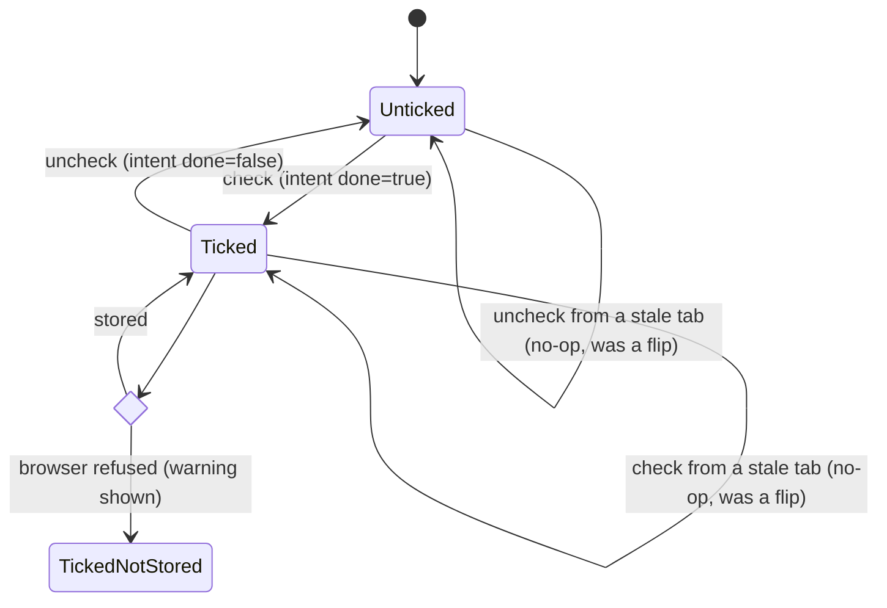
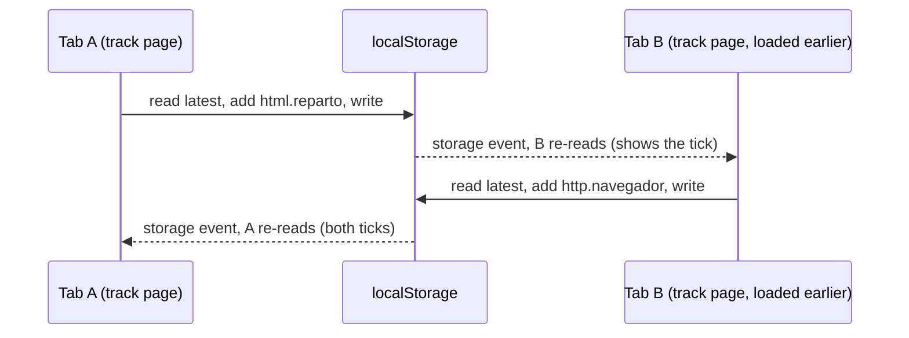
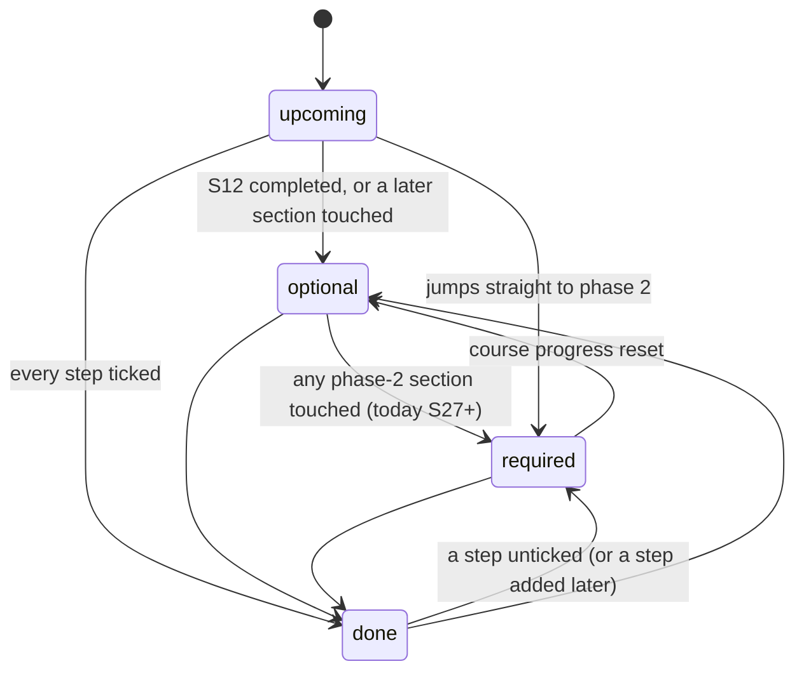
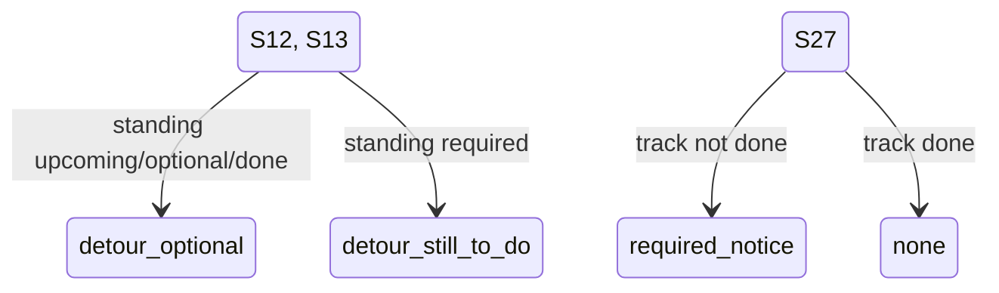
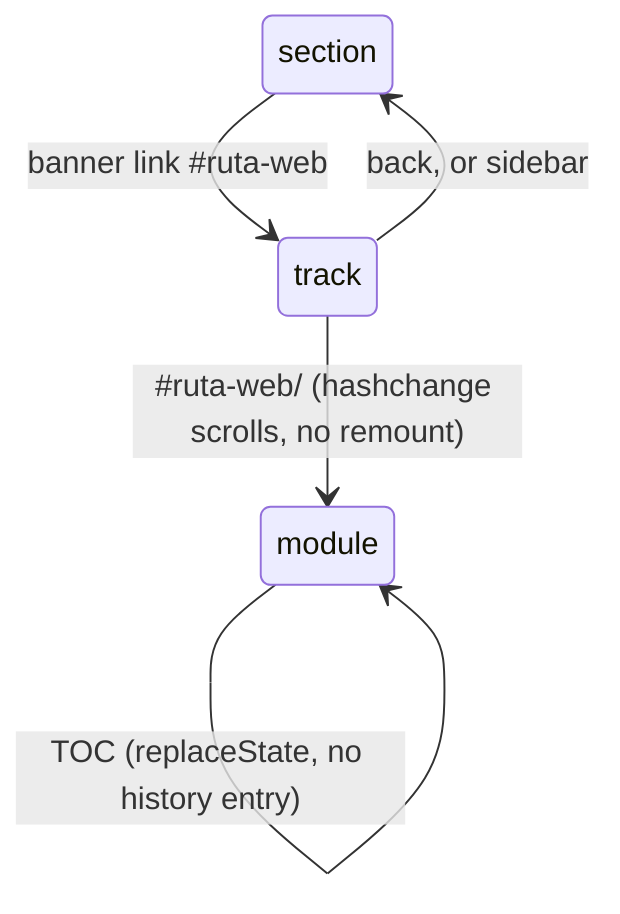

# Ruta «Python en la web»: state machines

Written 25 Nov 2026, for Pablo's request to find the implicit state machines in what the web track
adds, diagnose errant, colliding, contradictory or useless states, and check that every view shows
the same thing. Scope: the track only (his clarification), not the rest of the app.

Eight machines. SM1 to SM5 live in the app; SM6 to SM8 live on the learner's computer and are
what the lessons must explain. Each defect found has a test that fails with the defect present
(the mutation is named), and each fix is in this PR.

## SM1. One step's tick



| Finding | Kind | Fix | Test (mutation that turns it red) |
|---|---|---|---|
| The click was a flip of the page's copy. A stale tab that showed a step unticked, clicked, *unticked* it in storage. | contradictory transition | The checkbox sends its new state; `setTrackStep` applies the intent | "unticking in one tab does not resurrect or erase" (intent → flip) |
| A refused save could have dropped the tick from the page. | errant state | `commitTrackStep` returns the change with `saved: false`; the page shows it and warns | "a commit to a browser that refuses storage" (return empty when not saved) |
| A tick overwrote a stored record the page could not read (damaged, or written by a newer version), losing it. | destructive transition | The unreadable value is copied to `pyarcana:track:ruta-web:v1:unreadable:<time>` first; if the copy fails, nothing is written | "a tick never destroys a stored record it cannot read" (skip the backup) |

## SM2. Ticks across tabs and components



**Collision found:** before the fix each tab wrote its whole in-memory copy, so the last writer
erased the other tab's ticks, and a tab never learned of ticks made elsewhere until it reloaded.
**Fix:** every tick is applied to the latest stored record (read, change one id, write: the
localStorage analogue of an optimistic merge), and the hook listens to the `storage` event.

Patterns Pablo named, and why each does or does not apply here:

- **Optimistic locking**: applied in its merge form. A version check with retry is unnecessary
  because one tick is one idempotent set-or-clear of one id, and `localStorage` writes in one tab
  are synchronous, so read-change-write cannot interleave within a tab. Two tabs writing in the same
  millisecond still serialize through the browser's storage, and each applies its own single change.
- **Outbox**: not applicable. There is no server write to make reliable; the ticks never leave the
  browser (DESIGN.md §4). If ticks ever sync to an account, an outbox (queue the change locally,
  send, then mark it sent) is the pattern to use, and the progress document is where it would live.
- **Connection pooling**: not applicable. The track opens no connection. The learner's own
  programs (SM6) open one connection per request with `urllib`, which is right at that scale.

**Same tab, found in the browser in the follow-up round:** the track page, the section banner and
the new menu entry each kept their own copy, and a page never receives its own `storage` events,
so a tick on the track page left the menu's count and standing old. Fix: one store per page
(`src/lib/tracks/shared-state.ts`) read with `useSyncExternalStore`; every writer goes through it
and it notifies every reader, and it keeps the same snapshot when nothing changed so React does
not re-render in a loop. Test: "one copy per page" (notify only the first reader; always replace
the snapshot).

Evidence: `scripts/web_track_sync_check.cjs`, two real Chromium tabs and a phone viewport on the
static export, 22/22 (14/14 before the follow-up round). With the `storage` listener removed it fails 3 checks (B does not see A's tick, the counters
differ, the untick does not reach A).

## SM3. The track's standing



"Touched" means completed, open now, last opened, with a part done, or the furthest section this
browser has opened (a high-water mark the track keeps under `pyarcana:track:ruta-web:furthest:v1`).

**Contradiction found:** the track page has no open section, so a rule that read only completed
sections plus the open one said "upcoming" on the track page a moment after S27's banner said
"required". **Fix:** `trackStanding` also reads `lastVisited` and `completedSubSteps` (an empty
entry is not a visit). Test: "one standing everywhere" (ignore those inputs).

**Second contradiction, found in the browser after that fix:** the course keeps only the *last*
section opened, so a learner who opened S27 and went back to S12 or S02 dropped to "optional"
again. **Fix:** the track keeps the furthest section opened, by slug, and only raises it (an older
tab advances from the stored mark, never from its own copy). Test: "the standing does not forget
S27" (always overwrite the mark); browser: "after going back to S02, the track page still says
required". The exhaustive test
crosses 5 completion sets, 4 open sections and done/not done, asserts `done` always wins, never
"upcoming" past S12, never "optional" in phase 2, and that all four states are reachable.

**Backward transitions:** unticking a step moves `done` back, on purpose. Adding a step used to as
well, demoting every learner who had finished (and S27 told them again that the track was
required). Fixed in the follow-up round: the record carries `finished: true` once every step is
ticked, and only an untick clears it. New steps then show unticked in the count, while the
standing stays "done". Test: "a learner who finished stays done" (ignore the flag; keep it on
untick).

Resetting the course's progress does not lower the furthest mark, so the standing stays
"required" for a learner who had reached phase 2. Kept: reaching the advanced level is a fact
about this browser's history, and the mark lives in the track's own key, not the course record.

**Course progress across tabs (fixed in the follow-up round):** the course store did not follow
other tabs, so a tab left open showed old completion. `src/lib/progress-cross-tab.ts` re-reads
`python-ds-progress` through the store's own `persist` (parse, sanitize, migrate) when another tab
writes it, following the precedent of `theory-checkpoints.ts`; the store file is not changed. Routes
compared: (a) re-read through `persist.rehydrate()`, chosen, because it reuses the store's
validation; (b) parse the record here, rejected, because it duplicates a protected format and
drifts when the schema moves; (c) `BroadcastChannel` messages, rejected, because every writer would
have to post them and the store's writes do not. A removal (`newValue` null, also `clear()`) is not
re-read: re-reading an absent record keeps this tab's copy and writes it back at once. Trade-off:
for a signed-in learner, the second tab records the same changes in its cloud change log and
uploads them once more; the merge is last-write-wins per item, so the server state is the same.
Browser: a section completed in tab A shows in tab B's menu without reload, and tab A receives at
most one echo (no ping-pong).

## SM4. The banner on a section



**Contradiction found:** a learner already in phase 2 who went back to S12 read «Desvío
opcional» there and «Requerida» on the track page. **Fix:** on a detour section the title follows
the standing («Pendiente para el nivel avanzado»). Test: "a banner never contradicts the track
page" (always the optional title). The set of sections with a banner is unchanged and tested.

## SM5. Routing



Found in the first round and fixed then (DESIGN.md §6): hopping between modules did not scroll.
The TOC uses `replaceState`, so the back button leaves the track instead of walking every module
the learner jumped to; that is a choice, stated here.

## SM6 to SM8. What runs on the learner's computer

```mermaid
stateDiagram-v2
  state "SM6 local server" as SM6 {
    stopped --> serving: python -m http.server 8000
    stopped --> port_busy: port in use
    port_busy --> serving: another port (taught)
  }
  state "SM7 origin" as SM7 {
    file --> http: open http://localhost:8000 (taught; fetch fails on file://)
  }
  state "SM8 deploy" as SM8 {
    local --> committed --> pushed --> pages_off
    pages_off --> building: Settings → Pages, branch main
    pages_off --> no_main: Git named the branch master
    no_main --> pushed: git branch -M main (taught, this round)
    building --> live: one or two minutes
    building --> not_found: absolute path /data.json (taught)
  }
```

Every arrow marked "taught" is a «Si no funciona» entry whose commands were run: the learner walk
(`scripts/web_track_learner_walk.mjs`, 26/26) runs the server, the port conflict, `file://` against
`http://`, and `wrangler deploy --dry-run`. **Found this round:** a learner who skipped Sesión 0 on
an older Git gets `master`, and Settings → Pages offers no `main`. The new entry's two commands
were run against a repository created with `master` and a remote: `main` arrived.

## Red team, four passes over this round's changes

| Pass | Attack | Result |
|---|---|---|
| 1. Storage | Two tabs tick at once; storage refuses; storage holds a damaged or newer record | Tick loss and the overwrite of unreadable data found and fixed (SM1, SM2) |
| 2. Coherence between views | Compare the standing on S12, S27, S02 and the track page, in one tab and in two | Three contradictions found and fixed (SM3 twice, SM4); the cross-tab course store gap named |
| 3. Drift | Renumber the sections the prose cites ("FastAPI en S41") | The prose cites 15 sections by number. A test now pins each number to the slug it meant and simulates an insertion before S12; any change names the number and the file |
| 4. Learner side | Walk SM6 to SM8 on a fresh machine profile | The `master` branch case found and taught; the rest already covered and run |

## Follow-up round (Pablo: "fix issues identified")

| Issue named in the first round | Done |
|---|---|
| Course progress does not follow other tabs | Fixed (SM3, course progress across tabs) |
| Adding a step demotes learners who finished | Fixed (`finished` flag) |
| No menu entry for the track | Added beside Sesión 0, outside the 52-item list (the list's count is pinned by `lesson-navigation.test.ts` and announced by screen readers, so an entry inside it was rejected) |
| "Required" is advisory | Not changed: enforcing it changes what the level-3 badge claims. Put to Pablo as a decision |
| Ticks do not sync to an account | Not changed: needs a field in the progress document and its schema (protected). Put to Pablo |
| Content is Spanish only | Not changed: translating the learner prose is new prose for approval; the UI strings exist in all three languages |

Red team of the follow-up: a removal event resurrecting the record (fixed: not re-read); a re-read
loop between tabs (checked: one echo at most); a cloud double upload (stated above); the shared
store re-rendering on every storage event (fixed: snapshot kept when unchanged); the menu entry on
a phone (opens the track and closes the drawer, no overflow).
