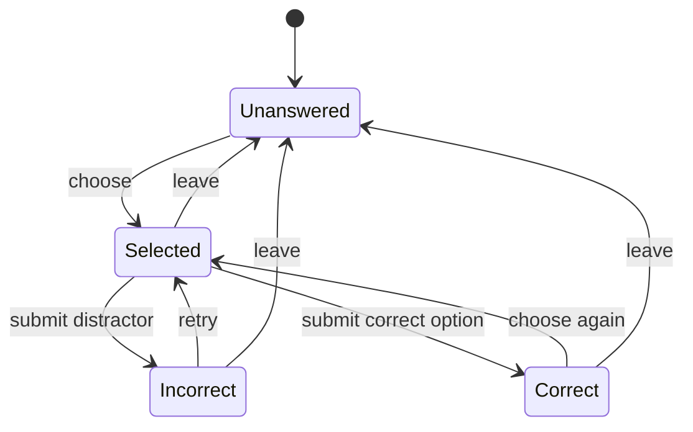
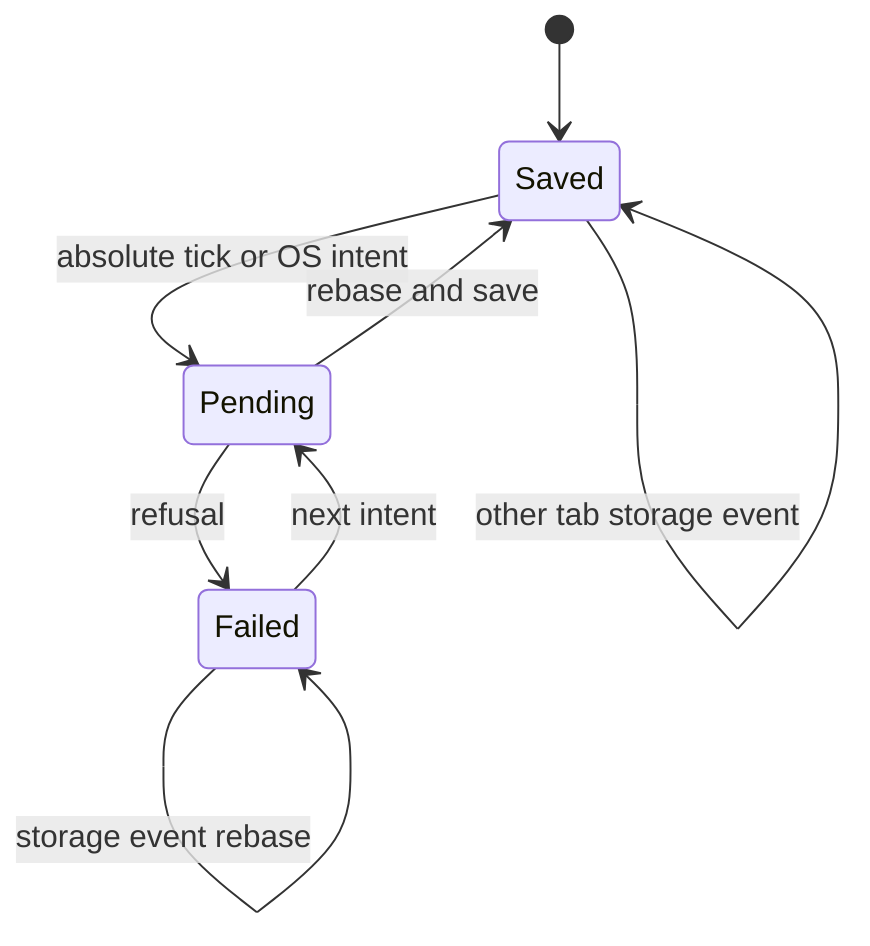

# Lesson parity audit — 26 Nov 2026

Baseline c02960609c866f1b1f3153347768541d4b4cd9d1. Source-only: canonical domain and Pages inaccessible in audit environment.
No production screenshots or release verdict.

Setup has OS-specific demonstrations, commands, images, expected output, recovery and manual ticks.
Web has six independent exercises, code, previews, solutions and manual checkpoints. Main sections
have separate theory, I do, we do, you do and assessed self-check surfaces. Rejected copying all
five tabs verbatim: real installations are not browser code exercises. First increment adds one
formative scenario per part/module (not installation proof or a score); existing IDs unchanged.
Content is Spanish; chrome translated. Full practice-phase redesign and novice review remain.

Setup saved stale snapshots; explicit intents now rebase on latest storage with pending retry.
Concurrent read/write across processes is not atomic; do not claim otherwise.
Web links replaced history and cancelled modifiers; native anchors restore history.
See STACK.md and STATE_MACHINES.md for full app. D1 binding needs no TCP pooling; existing
progress baseRev is optimistic concurrency. Existing worker deploy requires authorized operator.

Four release passes: pedagogy (check scenario validity, independent transfer); UX (same viewport
screenshots, keyboard, zoom, focus); state (wrong answers, failed storage, future IDs, history);
CI/release (both builds, complexity ratchet, preservation, live exact SHA). Added tests; execution
pending, no pass claimed. Current #126 failure pins checkout @v4 in exact-SHA deployment guard;
repair separately, not by weakening SHA contract. PR #104 proposes per-function complexity ratchet.
References: https://doi.org/10.1080/08993408.2019.1608781 ;
https://doi.org/10.1177/07356331231174454 ; https://www.w3.org/TR/WCAG22/ ;
https://playwright.dev/docs/best-practices ; https://eslint.org/docs/latest/rules/complexity .
