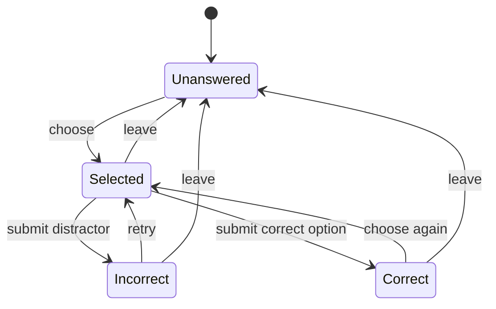
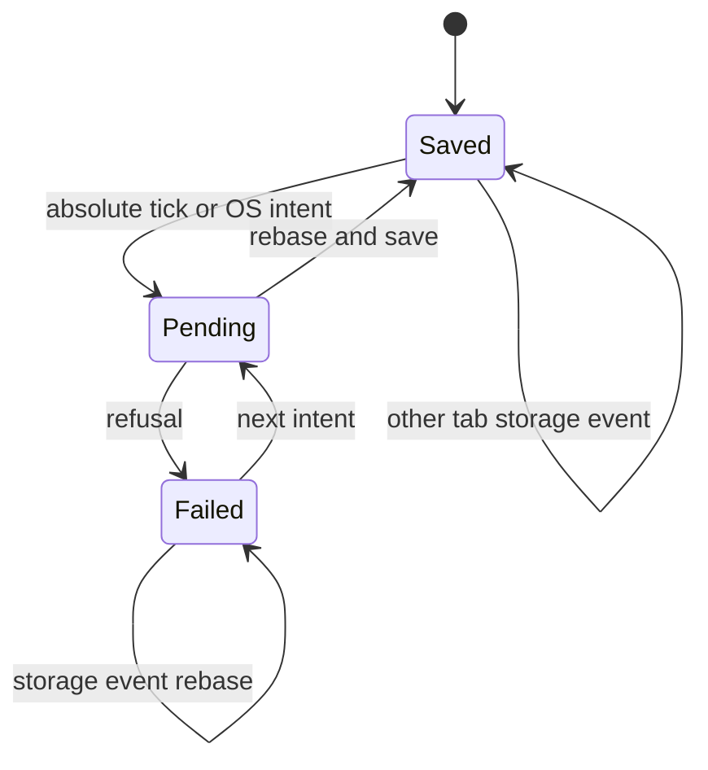
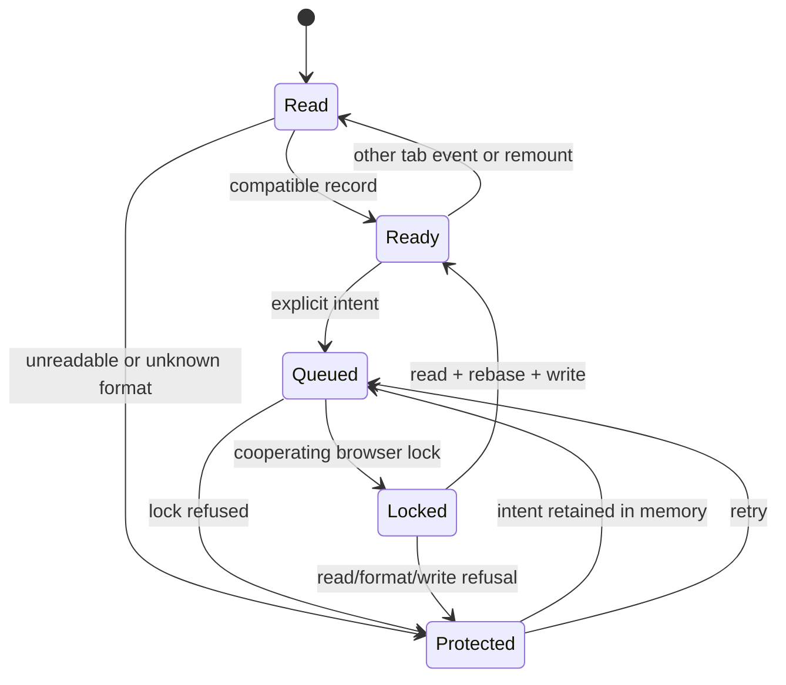

# Lesson parity audit — 26 Nov 2026

Baseline c02960609c866f1b1f3153347768541d4b4cd9d1. Source-only: canonical domain and Pages inaccessible in audit environment.
No production screenshots or release verdict.

Setup has OS-specific demonstrations, commands, images, expected output, recovery and manual ticks.
Web has six independent exercises, code, previews, solutions and manual checkpoints. Main sections
have separate theory, I do, we do, you do and assessed self-check surfaces. Rejected copying all
five tabs verbatim: real installations are not browser code exercises. First increment adds one
formative scenario per part/module (not installation proof or a score); existing IDs unchanged.
Content is Spanish; chrome translated. Full practice-phase redesign and novice review remain.

Setup saved stale snapshots; explicit intents now rebase on latest storage with pending retry.
Concurrent read/write across processes is not atomic; do not claim otherwise.
Web links replaced history and cancelled modifiers; native anchors restore history.
See STACK.md and STATE_MACHINES.md for full app. D1 binding needs no TCP pooling; existing
progress baseRev is optimistic concurrency. Existing worker deploy requires authorized operator.

Four release passes: pedagogy (check scenario validity, independent transfer); UX (same viewport
screenshots, keyboard, zoom, focus); state (wrong answers, failed storage, future IDs, history);
CI/release (both builds, complexity ratchet, preservation, live exact SHA). Added tests; execution
pending, no pass claimed. Current #126 failure pins checkout @v4 in exact-SHA deployment guard;
repair separately, not by weakening SHA contract. PR #104 proposes per-function complexity ratchet.
References: https://doi.org/10.1080/08993408.2019.1608781 ;
https://doi.org/10.1177/07356331231174454 ; https://www.w3.org/TR/WCAG22/ ;
https://playwright.dev/docs/best-practices ; https://eslint.org/docs/latest/rules/complexity .

## Second round — pre-execution routes and adversarial findings

The first revision passed nine jobs and the public-site journeys; the remaining static job was
still in its exhaustive lesson step at inspection. That evidence belongs only to the first SHA.

| Domain | Defect | Selected route | Rejected route and trade-off |
|---|---|---|---|
| Persistence | Failed reads became empty records, future records could be downgraded | Strict write admission, last known good projection, explicit retry and document-lifetime intents | Blind merge loses unknown fields; refusing incompatible records protects them but requires a compatible client to resume |
| Concurrency | cooperating tabs could interleave read/write | Web Locks when supported, synchronous read/rebase/write inside lock | Custom distributed localStorage mutex lacks a reliable atomic primitive; IndexedDB migration is wider and does not coordinate old writers. Unsupported browsers remain best-effort; rejected locks never bypass |
| Assessment | cues from answer length and fixed position, generic feedback | Similar plausible distractors, misconception-specific explanations, semantic option identities, shuffle on retry | More questions with weak distractors would inflate volume without validity. One item/module remains low-stakes, not mastery evidence |
| Transfer | setup lacks independent application | 7 concrete manual tasks with observable criteria | Browser cannot certify a learner's local installations; do not request private outputs or fake a sandbox |
| Regression | answer oracle derived from the key | Fixed semantic correct-answer fixture, storage failure and drift probes, actual two-tab journey | Snapshot-only checks would miss behavior; no UI snapshot counts as evidence of correctness |

Sources checked 26 Nov: MDN Web Locks https://developer.mozilla.org/en-US/docs/Web/API/Web_Locks_API ;
storage event https://developer.mozilla.org/en-US/docs/Web/API/Window/storage_event ;
KU Leuven item writing https://www.kuleuven.be/english/education/leuvenlearninglab/support/assessment-feedback/design-assessment-and-feedback/designing-an-exam-or-test/multiple-choice-questions ;
Butler & Roediger (2008) https://pubmed.ncbi.nlm.nih.gov/18491500/ ;
PRIMM https://doi.org/10.1080/08993408.2019.1608781 ;
WCAG status messages https://www.w3.org/WAI/WCAG22/Understanding/status-messages.html ;
Playwright https://playwright.dev/docs/best-practices .

### Failure and mutation ledger

- State: deny getItem while allowing setItem; old code could overwrite. Reject v2/unknown fields,
  malformed data and cap overflow; raw bytes remain. Rejected lock must not call writer.
- UI: two actual tabs, explicit untick, navigation and reload; retry shuffles options but evaluates
  identities, not displayed indices. Browser tests are in the existing CI journey suite.
- Pedagogy: semantic answer keys independent of the scored key; incorrect feedback is distinct.
  A formal novice pilot and measured discrimination/difficulty remain unexecuted.
- Deployment: exact new SHA CI required. No canonical production access, no production certificate.
  The probes are committed; actual red/green mutation execution and fresh CI must be recorded
  separately. LocalStorage fallback and old clients cannot promise atomic concurrency.

