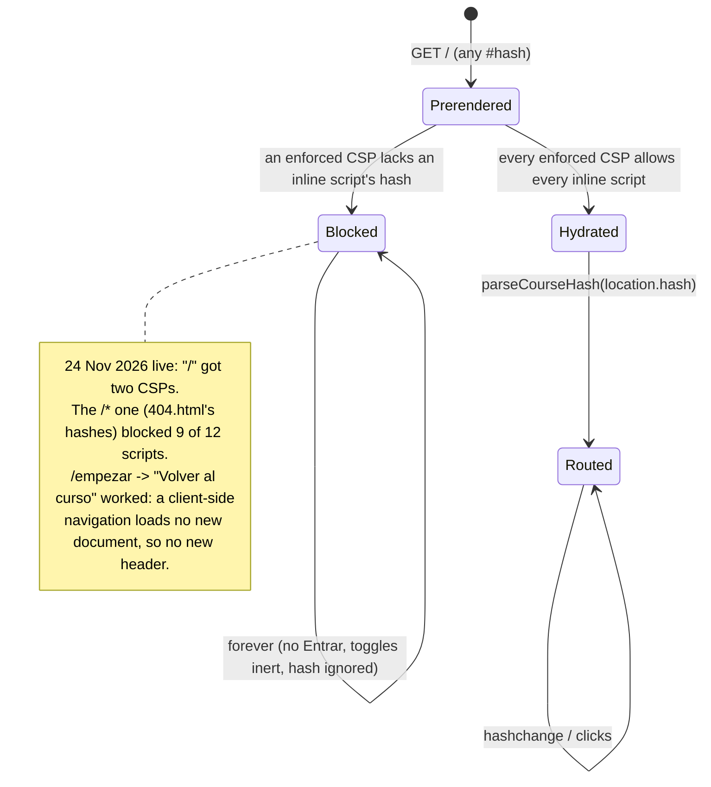
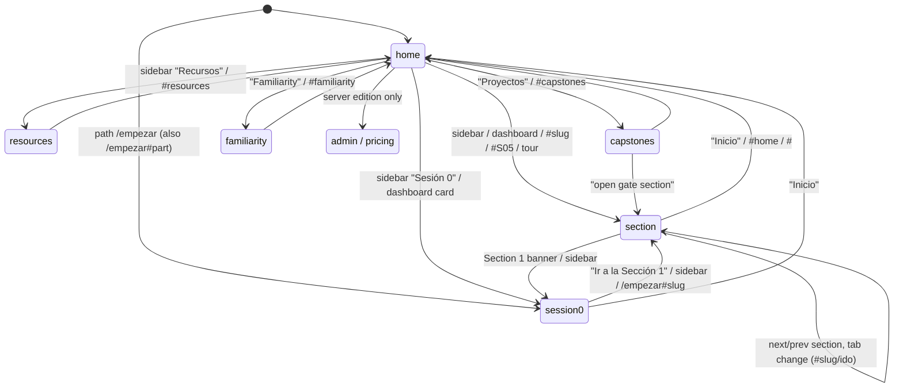
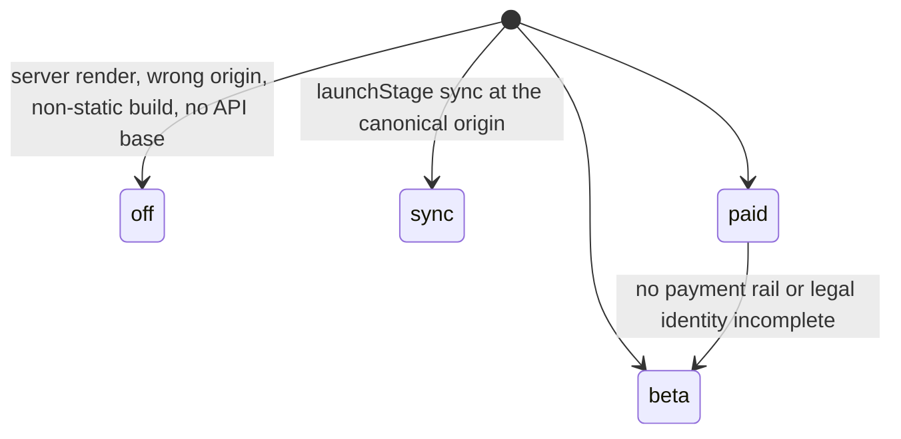
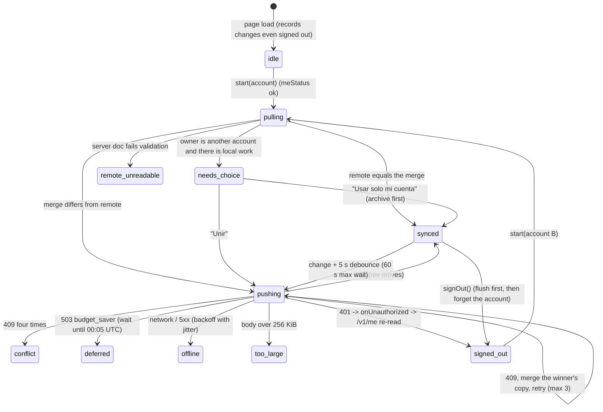
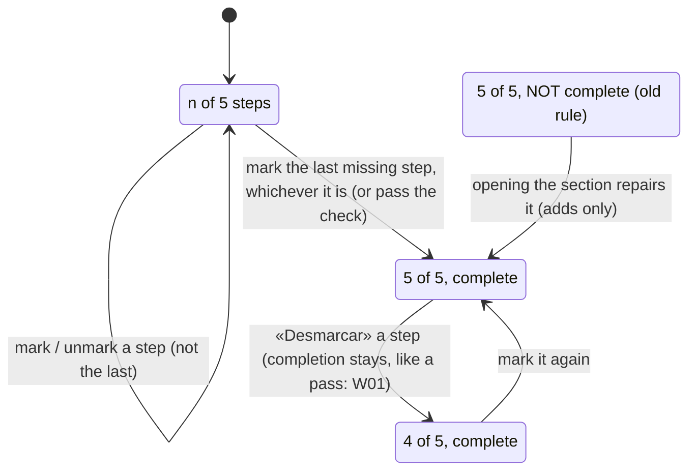
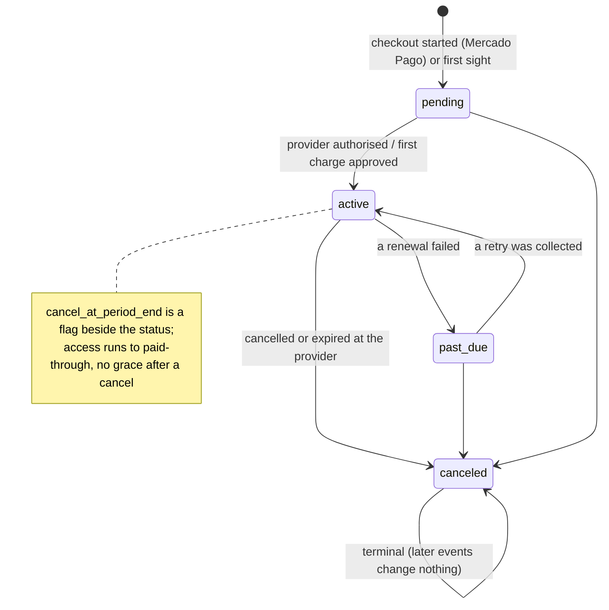

# Implicit state machines of PyArcana

Sections 0 to 6 were mapped 24 Nov 2026 while fixing the dead landing on `https://pyarcana.dev/#setup`;
sections 4 and 7 to 14 were extended app-wide on 25 Nov 2026 (the web track's own machines are in
`audit/tracks/web/STATE_MACHINES.md`, PR 196). None of these
machines is declared as one; each is a set of `useState`/store fields whose combinations decide
what a learner sees. Each section names the file, draws the states, and lists the errant states
found, with what was done about each. Diagrams are Mermaid (GitHub renders them).

## 0. Document boot: the machine that failed

Every `/#...` link is the same document (`out/index.html`). The hash only matters after React
hydrates, and React hydrates only if the browser runs the page's inline scripts (Next.js RSC
payload, `self.__next_f.push(...)`).



Why the symptoms matched exactly: `ThemeToggle` renders an inert placeholder until `mounted`
(src/app/page.tsx), `AccountButton` renders nothing until the cloud stage is read after mount
(src/components/account/AccountButton.tsx), and `LanguageToggle` needs a click handler. All three
wait for hydration, which never came.

Fix: `src/lib/cloud/headers.ts` (the `/*` policy carries no hashes, so any rule order is safe),
proved by `verifyHeadersFile` in every order at deploy (`scripts/cloud-headers.mjs` refuses),
`src/lib/cloud/__tests__/headers.test.ts`, and `scripts/hash_route_entry_check.mjs` against
`scripts/serve_out_rule_order.mjs` (production's order replayed locally) or the live site.

## 1. Course view (src/app/page.tsx + src/lib/course/hash-route.ts)

State: `view` × `activeSectionId` × `activeSubStep`, mirrored in `location.hash`.



Sesión 0 is the one view with a path instead of a hash: `/empezar` renders the same shell, which
opens on `session0` when the path says so (`parseCourseLocation`). Leaving it for any other view
rewrites the path back to the course root (`coursePathFor`), so a reload opens what is on screen.
A Next.js link to `/empezar` while Next still holds that page only changes the path, so the shell
also follows `usePathname()`. Record and differences: `audit/session-0/SHELL_PARITY.md`.

| Errant state | Before | Now |
|---|---|---|
| `view = 'section'` with an id no section has | blank `<main>` (no section to render) | `handleSelectSection` refuses it with a console error and stays (hash-route.ts `findCourseSection`) |
| `#familiarity` on desktop | header crumb empty | crumb says "Familiarity" |
| unknown hash (`#no-such-route`) | silently ignored | still ignored (the current view stays), now with a console warning naming the hash |
| `#admin`, `#pricing` on the static site | fell into the section lookup and found nothing | refused explicitly (`serverOnly`) |
| `#__proto__`, `#constructor` | fell through (no own-property check) | null, tested |
| `/empezar` | the setup guide alone: no menu, no top bars, no footer | the course shell on the `session0` view, tested in hash-route.test.ts and safe_agent_journeys.spec.ts |
| a section opened from `/empezar` | (not reachable: no menu) | address moves to the root (`/#basics`), never `/empezar#basics` |

Left as is, stated: an unknown hash keeps a URL that does not match the view until the next
navigation rewrites it. Rewriting it to the current view would lose what the person typed.

## 2. Section tabs (SUB_STEPS, src/lib/progress-store.ts)

`theory → ido → wedo → youdo → quiz`, written to the hash as `#slug` (Teoría) or `#slug/<tab>`;
an unknown tab name falls back to Teoría (tested for all 52 sections × 5 tabs).

## 3. Edition and access (src/lib/cloud/config.ts, access.ts)



`AccessState` = `unknown | pro | free`, from `MeStatus` (`idle → pending → ok | signed_out |
unavailable | error`) and the cached licence only when `/v1/me` is unreachable. `unknown` exists
so the upsell never flashes at a Pro learner. Consequence worth knowing: on `localhost` or any
preview origin the stage is `off`, so no account button appears there by design; browser checks
off the canonical origin must not expect one (`NO_ACCOUNT=1`).

## 4. Progress sync (src/lib/cloud/progress-sync.ts, workers/billing/src/progress.mjs)

`SyncStatus`: `idle, pulling, pushing, synced, offline, deferred, conflict, too_large,
remote_unreadable, needs_choice, signed_out, error`. Writes carry `baseRev`; the server updates
`WHERE rev = baseRev` and answers 409 with the winner's copy (optimistic locking). A different
account's progress on this device leads to `needs_choice` (merge or use the account's copy),
after an archived byte-exact copy of the local one.



One `ProgressSync` serves the whole page (`components/account/runtime.ts`), so it outlives a
sign-out. Everything learnt from one account's server is per account: revision, the acknowledged
document, back-off, budget hint, forced-sync state (`forgetAccount`).

| Errant state (25 Nov 2026) | Before | Now | Test (mutation that turns it red) |
|---|---|---|---|
| Sign out of A, sign in to an empty B on the same page, «Unir» | `push()` matched A's acknowledged document, said `synced` and uploaded nothing: B's server stayed empty | sign-out (and a direct A to B start) forgets the ack | `sync-session-machines.test.ts` (drop the reset; drop the A to B check) |
| A 401 on sync while `/v1/me` said ok | sync line `signed_out`, panel «Mi cuenta», access Pro, every change uploaded and refused again | `onUnauthorized` re-reads `/v1/me` once (unless a read is in flight or the page already knows; also after an `unavailable` read); its 401 moves the session to `signed_out` and stops the sync | same file (drop the callback; call it for any failure; ignore meStatus) |

## 4a. Session and sign-in methods (src/lib/cloud/session.ts, components/account/runtime.ts)

`MeStatus` `idle → pending → ok | signed_out | unavailable | error` is read once per load, again
after a sign-in, refresh, trial, and now after a sync 401. The sign-in methods store was
`idle → loading → ok | failed` with `failed` final for the page: one dropped connection when the
dialog first opened left «no disponible» in every sign-in panel until a reload. Now `failed` →
`loading` when the next panel mounts; `loading` and `ok` never send a second request (same test file).

## 5. Consent (src/lib/cloud/consent.ts)

`granted | denied | needed | not_required`; GPC or DNT short-circuits to "never measure, never ask".

## 6. Presentation state (theme, language, tour)

Theme (`next-themes`, class on `<html>`), language (`useI18n`, persisted), first-visit tour
(`localStorage['pyarcana:tourCompleted']`). All three are client-only and wait for hydration;
that is why a hydration failure shows as "the toggles do nothing".

## 7. Section completion (src/components/course/SectionView.tsx, src/lib/section-completion.ts)

Five steps per section (`theory → ido → wedo → youdo → quiz`, any order) and one fact,
`completedSections`, read by the header badge, the menu, the dashboard count and «Continuar».



**Contradiction found:** only a self-check pass marked the section. Check first and «Tú haces» last
gave five done steps, a header that said «Completada» (it read the steps), and a menu, dashboard
and «Continuar» that said not done (they read `completedSections`), until the check was retaken.
**Fix:** `stepToggleChanges` completes on whichever step is last; the header reads
`completedSections`; the old state is repaired on opening; completion is added with an idempotent
`setState`, never the store's toggle (a doubled effect or double click could un-complete).
Tests: `section-completion.test.ts` drives all 120 step orders; browser: `states.e2e.mjs` C1, C2.

Not changed, stated: a step's button is still a toggle of the store's copy. Within one tab that copy
is live; across tabs it is stale until `progress-cross-tab.ts` (PR 196, now merged) re-reads it.

## 8. Subscription (workers/billing/src/ledger.mjs, mp-sync.mjs, creem-sync.mjs)



Guards already in place, re-checked: an older provider time than the stored one is ignored;
`canceled` is terminal; every change opens with a compare-and-set on `version` (PR 197) and
retries on a lost lock; a first sight is a plain INSERT so two cannot both create a row.

## 9. Checkout (workers/billing/src/checkout.mjs, retention.mjs)

`open → completed` (the provider confirms, also after it was swept) and `open → expired` (provider
refused at start, or 7 days old, swept by the daily cron). One open checkout younger than an hour
blocks a new one, claimed in one `INSERT … WHERE NOT EXISTS` so two tabs cannot both reach the
provider. Trade-off kept: a learner who abandons the provider page waits up to an hour before a new
checkout; the message says a payment may be in progress, which is true until the provider answers.

## 10. Bug report triage (workers/billing/src/report-triage.mjs)

`new, triaged, fixed, wontfix, duplicate` (any to any by an admin or QA supervisor), with
`duplicateOf` set exactly when the status is `duplicate`.

**Contradiction found:** A duplicate of B, then B duplicate of A was accepted: both closed as
copies of each other, no open report left for the bug. **Fix:** the target must not itself be a
duplicate (400 `duplicate_of_duplicate`, shown to the admin as the reason code); that makes every cycle impossible, because the edge that would close one always points
at a duplicate. Chains (A → B, then B → C) are still possible and harmless: follow them. Rows that
already form a cycle are not rewritten; an admin reopens one. Test: `reports.test.mjs` (accept any
existing target).

## 11. Sign-in code (workers/billing/src/logincodes.mjs)

`issued → consumed | expired | locked (5 attempts)`; attempts and consumption are single
conditional UPDATEs (`… AND consumed_at IS NULL`, `… AND attempts < 5`), and a successful sign-in
consumes every other live code for the address. No defect found.

## 12. D1 budget level (workers/billing/src/usage.mjs)

Per UTC day: `green < 60 % ≤ amber < 85 % ≤ red`, from the larger share of rows read or written.
Amber slows sync to once a minute and samples events; red answers progress writes 503 until
00:05 UTC (the client's `deferred`). Every request flushes first when 5 minutes passed or the
day changed (router.mjs), so a cold isolate reads the day's stored total before deciding. The
residue, stated in usage.mjs: other isolates' unflushed tallies (up to 5 minutes each) are not seen,
so a level can lag by that much traffic. No defect found.

## 13. Patterns, and where each applies

- **Optimistic locking:** progress (`rev`), subscriptions (`version`, PR 197). Not added elsewhere:
  report triage and roles are admin-only, low-rate, and audited; a lost update there is visible
  in the audit log. Stated, not absorbed.
- **Outbox:** the progress change log (`pyarcana-cloud-changes-v1`) is the client's outbox; billing
  reconciles from the provider instead (STACK.md). Events (`events.mjs`) are best-effort by design.
- **Connection pooling:** not applicable; D1 is a per-request binding (STACK.md).

## 14. Ledger of this audit

| # | Machine | Defect | Status |
|---|---|---|---|
| 1 | Progress sync | account switch on one page uploads nothing | fixed, tested, browser C3 |
| 2 | Sync × session | 401 on sync never reaches the session | fixed, tested, browser C4 |
| 3 | Sign-in methods | `failed` final until reload | fixed, tested |
| 4 | Section completion | header and menu disagree when the check is not last | fixed, tested, browser C1, C2 |
| 5 | Report triage | duplicate cycles close the only report | fixed, tested |
| 6 | Course store across tabs | stale tab toggles and overwrites | fixed in PR 196 (merged) |
| 7 | Checkout | abandoned checkout blocks one hour | kept, stated (§9) |
| 8 | Budget meter | level lags other isolates by up to 5 min | kept, stated (§12) |

## How to re-check

```bash
node --import tsx --test src/lib/cloud/__tests__/sync-session-machines.test.ts src/lib/cloud/__tests__/section-completion.test.ts
node --test workers/billing/tests/reports.test.mjs
(cd workers/billing/e2e && ./run.sh)            # includes states.e2e.mjs: every view after every step
node --import tsx --test src/lib/course/hash-route.test.ts src/lib/cloud/__tests__/headers.test.ts
NEXT_PUBLIC_BASE_PATH= node scripts/build_static_export.mjs && node scripts/cloud-headers.mjs out
node --import tsx scripts/serve_out_rule_order.mjs --order sorted &   # production's order
NO_ACCOUNT=1 BASE=http://localhost:8788 node scripts/hash_route_entry_check.mjs
BASE=https://pyarcana.dev node scripts/hash_route_entry_check.mjs     # after a deploy
```
