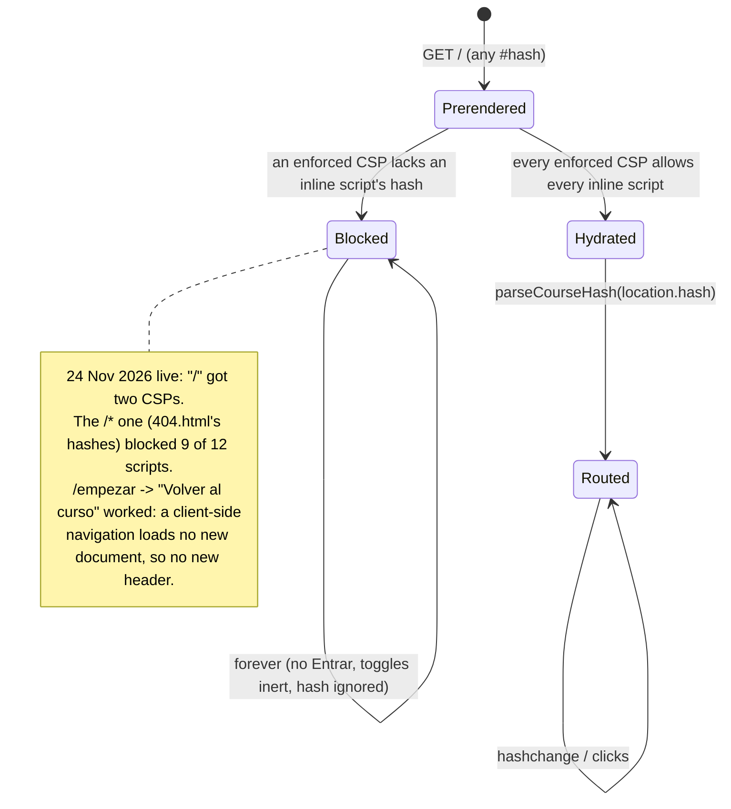
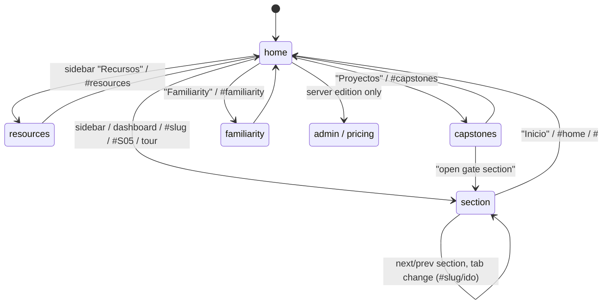
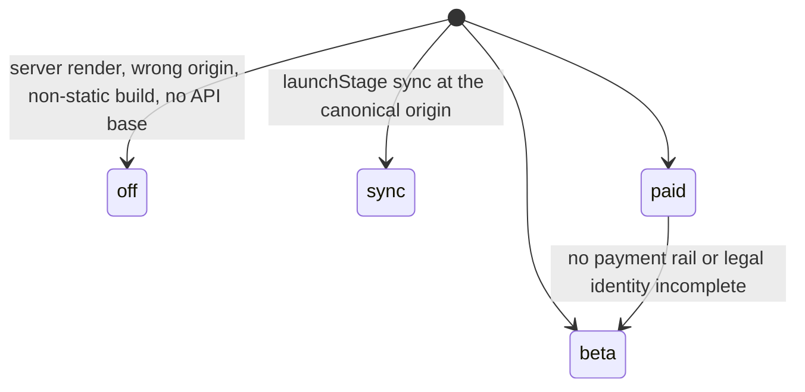

# Implicit state machines of the course page

Mapped 24 Nov 2026 while fixing the dead landing on `https://pyarcana.dev/#setup`. None of these
machines is declared as one; each is a set of `useState`/store fields whose combinations decide
what a learner sees. Each section names the file, draws the states, and lists the errant states
found, with what was done about each. Diagrams are Mermaid (GitHub renders them).

## 0. Document boot: the machine that failed

Every `/#...` link is the same document (`out/index.html`). The hash only matters after React
hydrates, and React hydrates only if the browser runs the page's inline scripts (Next.js RSC
payload, `self.__next_f.push(...)`).



Why the symptoms matched exactly: `ThemeToggle` renders an inert placeholder until `mounted`
(src/app/page.tsx), `AccountButton` renders nothing until the cloud stage is read after mount
(src/components/account/AccountButton.tsx), and `LanguageToggle` needs a click handler. All three
wait for hydration, which never came.

Fix: `src/lib/cloud/headers.ts` (the `/*` policy carries no hashes, so any rule order is safe),
proved by `verifyHeadersFile` in every order at deploy (`scripts/cloud-headers.mjs` refuses),
`src/lib/cloud/__tests__/headers.test.ts`, and `scripts/hash_route_entry_check.mjs` against
`scripts/serve_out_rule_order.mjs` (production's order replayed locally) or the live site.

## 1. Course view (src/app/page.tsx)

State: `view` × `activeSectionId` × `activeSubStep`, mirrored in `location.hash`.



| Errant state | Before | Now |
|---|---|---|
| `view = 'section'` with an id no section has | blank `<main>` (no section to render) | `handleSelectSection` refuses it with a console error and stays |
| `#familiarity` on desktop | header crumb empty | crumb says "Familiarity" |
| unknown hash (`#no-such-route`, `#S99`, `#__proto__`) | ignored; the current view stays | unchanged (checked in the browser by `hash_route_entry_check.mjs`) |
| `#admin`, `#pricing` on the static site | fall into the section lookup, find nothing, ignored | unchanged |

Left as is, stated: an unknown hash keeps a URL that does not match the view until the next
navigation rewrites it. Rewriting it to the current view would lose what the person typed.

Not done, and why: the router is still inline in page.tsx. Moving it into a pure, unit-tested
module (tried on this branch) breaks `tests/adversarial/test_disclaimer_and_substep_preservation.py`,
which pins the router's source text in page.tsx. `tests/` is a protected path, so that move waits
for the owner's go-ahead to let the test read the new module instead.

## 2. Section tabs (SUB_STEPS, src/lib/progress-store.ts)

`theory → ido → wedo → youdo → quiz`, written to the hash as `#slug` (Teoría) or `#slug/<tab>`;
an unknown tab name falls back to Teoría.

## 3. Edition and access (src/lib/cloud/config.ts, access.ts)



`AccessState` = `unknown | pro | free`, from `MeStatus` (`idle → pending → ok | signed_out |
unavailable | error`) and the cached licence only when `/v1/me` is unreachable. `unknown` exists
so the upsell never flashes at a Pro learner. Consequence worth knowing: on `localhost` or any
preview origin the stage is `off`, so no account button appears there by design; browser checks
off the canonical origin must not expect one (`NO_ACCOUNT=1`).

## 4. Progress sync (src/lib/cloud/progress-sync.ts, workers/billing/src/progress.mjs)

`SyncStatus`: `idle, pulling, pushing, synced, offline, deferred, conflict, too_large,
remote_unreadable, needs_choice, signed_out, error`. Writes carry `baseRev`; the server updates
`WHERE rev = baseRev` and answers 409 with the winner's copy (optimistic locking). A different
account's progress on this device leads to `needs_choice` (merge or use the account's copy),
after an archived byte-exact copy of the local one.

## 5. Consent (src/lib/cloud/consent.ts)

`granted | denied | needed | not_required`; GPC or DNT short-circuits to "never measure, never ask".

## 6. Presentation state (theme, language, tour)

Theme (`next-themes`, class on `<html>`), language (`useI18n`, persisted), first-visit tour
(`localStorage['pyarcana:tourCompleted']`). All three are client-only and wait for hydration;
that is why a hydration failure shows as "the toggles do nothing".

## How to re-check

```bash
node --import tsx --test src/lib/cloud/__tests__/headers.test.ts
NEXT_PUBLIC_BASE_PATH= node scripts/build_static_export.mjs && node scripts/cloud-headers.mjs out
node --import tsx scripts/serve_out_rule_order.mjs --order sorted &   # production's order
NO_ACCOUNT=1 BASE=http://localhost:8788 node scripts/hash_route_entry_check.mjs
BASE=https://pyarcana.dev node scripts/hash_route_entry_check.mjs     # after a deploy
```
